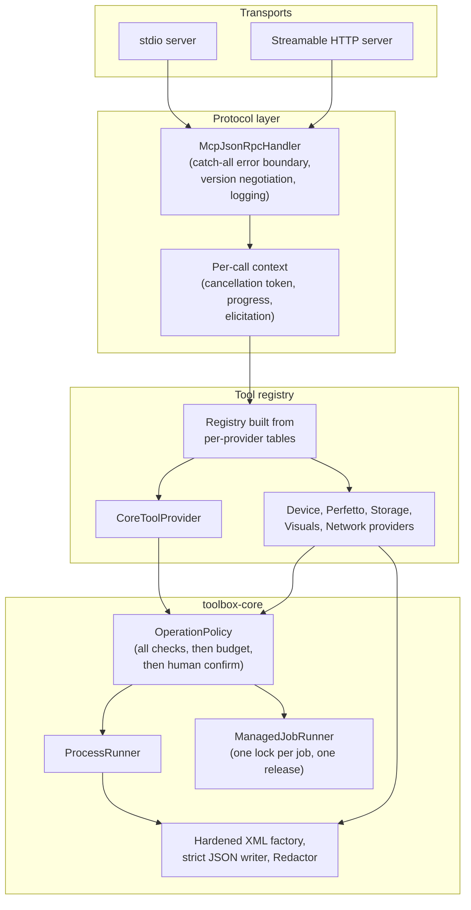

# DroidAgentKit: roadmap and architecture plan

> **Status**: working draft, checked against the code on 4 October 2026 (`4e0b8ec`).
> **Current version**: 0.3.1-alpha is published (`npm` `latest`). `main` has unreleased fixes for the nightly job, Perfetto capture, and Dependabot.
> **Target versions**: 0.3.1 (ship what's done) ➔ 0.4.0 (trust the results) ➔ 0.5.0 (understand
> real projects) ➔ 0.6.0 (Android depth) ➔ 1.0.0
> **Audience**: maintainers and contributors
> **Companion doc**: [IMPROVEMENTS.md](IMPROVEMENTS.md) holds the item-by-item backlog with file
> references. Item numbers below point there.

---

## 1. Summary and current state

DroidAgentKit is a local MCP server that gives AI coding agents real Android tools, such as Gradle,
adb, lint, Perfetto and app storage. It puts a permission layer in front of them instead of raw
shell access. It also ships a readiness auditor and a visual regression kit.

At 0.3.0-alpha it ships:
- 63 MCP tools in 7 groups: `core` (on by default), `device_read`, `device_control`, `perfetto`,
  `visuals`, `storage` and `network_experimental`.
- A trust split: grants come only from the user policy, and a project config can only narrow
  them. A property test checks this.
- Cancellation, progress notifications, and opt-in human confirmation through MCP elicitation
  (a way for the server to ask the user a question through the host).
- `audit`, which scores a repo and writes AGENTS.md and a project skill.
- Install through npm (with an auto-provisioned JRE), an MCPB bundle, and Homebrew.
- CI on three OSes, Kover, detekt, CodeQL and Scorecard.

### Gaps found in the October review

1. **Release and CI, since closed.** `npm` `latest` is 0.3.1-alpha. The nightly job passes on API 30
   and 34 and opens an issue when it fails. Dependabot merges patch and minor updates. The old
   registry listings are deprecated. (Items 1–5, done by 14 October.)
2. **Two holes in the trust model.** An agent can choose the program `android_perfetto_analyze`
   runs. A broken project config makes the server ignore the user policy. (Items 6, 7.) XXE in
   two device parsers is close behind (item 8).
3. **Several advertised analyses return nothing on real data.**
   - All Perfetto queries fail against real traces.
   - Storage misses Room databases without a `.db` suffix.
   - `android_input_key` can't succeed.
   - The generated SKILL.md is malformed.
   - The dumpsys parsers expect formats Android doesn't print.
   
   Tests didn't catch these because the fixtures were written by hand. (Items 13–18, 31.)
4. **Some server failures are silent.**
   - A tool exception leaves the client waiting.
   - Control characters produce invalid JSON.
   - Cancelling doesn't stop Gradle.
   - Job locks drift.
   
   (Items 21–24.)
5. **The inspector misreads modern builds.** On a Now in Android-shaped project, the module graph
   is empty, flavors are invisible, and the commands it suggests may not exist. (Items 29, 30.)
6. **The dispatcher is hard to extend.** One 1,714-line class holds the core tools, and each
   provider lists its tools three times. (Items 33–35.)

---

## 2. Landscape

The positioning from [the August research](research/android-mcp-landscape.md) still holds:
DroidAgentKit is the Android *developer-workflow* server. It goes deep into the build system and
toolchain and doesn't cover iOS. Competitor numbers in that doc are as of August 2026 and haven't
been rechecked.

The platform changes that matter for this roadmap:

```
┌──────────────────────────┬──────────────────────────┬──────────────────────────┐
│  Android builds          │  Performance tooling     │  MCP protocol            │
│  • AGP 9 built-in Kotlin │  • Perfetto stdlib SQL   │  • logging capability    │
│  • New compileSdk DSL    │    modules (startup,     │  • listChanged           │
│  • Convention plugins in │    binder, frames)       │  • Tasks for long jobs   │
│    build-logic           │  • Macrobenchmark traces │  • Structured output     │
│  • Type-safe accessors   │    as input              │    schemas per tool      │
├──────────────────────────┼──────────────────────────┼──────────────────────────┤
│  Screenshot testing      │  App data                │  Agent hosts             │
│  • Roborazzi             │  • Room with free-form   │  • Android Studio agent  │
│  • Paparazzi             │    database names        │    mode (HTTP client)    │
│  • Compose Preview       │  • DataStore replacing   │  • Elicitation support   │
│    screenshot testing    │    SharedPreferences     │    varies by host        │
└──────────────────────────┴──────────────────────────┴──────────────────────────┘
```

- **AGP 9** (Android Gradle Plugin 9) builds Kotlin in by default and adds a new SDK DSL. The
  inspector needs both (item 29).
- **The Perfetto standard library** (`INCLUDE PERFETTO MODULE …`) gives tested tables for startup,
  binder, frames and lock contention. Hand-written SQL against raw tables is what broke item 14.
- **Screenshot testing** in real projects mostly runs on Roborazzi, Paparazzi or Compose Preview
  screenshot testing. The visuals kit should read their output rather than ask for raw PNGs.
- **MCP**: hosts increasingly expect `logging`, per-tool output schemas, and tolerance of more than
  one protocol version.

---

## 3. Architecture direction

The shape stays the same: a pure-JVM Kotlin monorepo, capability-gated tool groups, every command
run through `ProcessRunner`, and grants only from the user policy. The changes harden the seams
between the parts.



What changes:
- **One error boundary** in `McpJsonRpcHandler`. Every request gets a reply, even when a tool
  throws (item 21).
- **One per-call context**, passed on every path. Core tools and the workspace dispatcher stop
  dropping it (item 23).
- **A tool registry built from tables.** Each provider declares each tool once: schema, handler,
  annotations and group. The core tools become a provider like the rest (items 33, 34).
- **Shared safe utilities** in `toolbox-core`: one hardened XML factory, a JSON writer that escapes
  every control character, and stronger redaction (items 8, 11, 22).
- **Recorded fixtures**: real device and tool output as test input, so parsers are tested against
  what Android prints (item 31).

What stays fixed:
- No new runtime dependencies. `toolbox-core` stays dependency-free.
- MCP tool names are stable API. Schema changes are additive, except where a security fix requires
  removing an argument (item 6).
- Any new config key that grants anything is policy-only and is added to the trust-split tests.

---

## 4. Proposed features

### F1: One table per tool provider, with a schema-parity test
**Problem**: each provider lists every tool in three places, and nothing checks that a schema
property is actually read. That's how `android_input_key` shipped broken (item 13).

**Specification**:
```kotlin
// One entry per tool. supports(), tools/list and dispatch all derive from this list.
data class ToolEntry(
    val tool: McpTool,                      // name, description, input schema, annotations
    val group: ToolGroup,
    val handler: (Map<String, Any?>) -> Map<String, Any?>,
)
```
- `DroidAgentMcpDispatcher`'s core tools move into `CoreToolProvider`.
- A test walks every entry and fails when a required schema property is never read.
- The manifest test compares against a checked-in golden JSON, so a failure shows a diff
  (item 35).

### F2: Perfetto that works on real traces
**Problem**: every analysis fails on a real trace, and the default capture records almost nothing
useful (item 14).

**Specification**:
- Ship one versioned capture config: `linux.ftrace` with sched, CPU frequency and binder events,
  atrace categories `am wm gfx view dalvik binder_driver` with `atrace_apps=<package>`, plus
  frame timeline, process stats and package list.
- Rewrite every query on the Perfetto standard library, with a `packageName` filter.
- New analyses: `startup` (from `android.startup.startups`) and `memory` (RSS and heap counters).
- Accept the `.perfetto-trace` files that `android_test_run` macrobenchmarks already produce.
- Check in one small real trace and run every query against it in an opt-in test.

### F3: An inspector that understands modern builds
**Problem**: on a Now in Android-shaped project, the inspector returns no module graph, no flavors
and no `applicationId`. The commands it puts in AGENTS.md may not exist (items 29, 30).

**Specification**:
- Parse type-safe accessors (`projects.core.domain`), flavors and build types in both DSLs,
  `applicationId` and its suffix, the AGP 9 `compileSdk { version = release(N) }` form, and catalog
  references.
- Resolve convention plugins written as `pluginManager.apply`, in `buildSrc`, and as precompiled
  script plugins.
- Strip comments before parsing.
- Build the command matrix per variant.
- Optional, off by default: a `probeTasks` flag that runs `./gradlew tasks --all` through the
  allowlist to confirm task names. This executes Gradle, so it stays behind the existing Gradle
  capability.
- Replace the toolchain table with the published AGP–Gradle–JDK compatibility ranges. Read the
  project's Gradle JDK, not the server's.

### F4: Storage inspection that fits real apps
**Problem**: Room databases without a `.db` suffix are invisible, and every query force-stops the
app (item 15).

**Specification**:
- Detect SQLite files by header.
- Cache one snapshot per device and package. Add a `refresh: true` argument.
- Make force-stop opt-in (`forceStop: true`).
- New: decode DataStore Preferences files (`files/datastore/*.preferences_pb`). It's a small
  protobuf wire-format reader, with no new dependency.
- New: compare an exported Room schema JSON (`schemas/…/N.json`) with the live `sqlite_master` and
  report missing or extra columns. That's a common cause of migration crashes.

### F5: Visual regression that fits existing screenshot stacks
**Problem**: diffs fail on one anti-aliased pixel, the kit can't be installed, and teams already use
other screenshot tools (items 19, 36).

**Specification**:
- Count a pixel as changed only above the color-distance threshold, then apply the percentage.
  Add optional masked regions.
- Importers that treat Roborazzi, Paparazzi and Compose Preview screenshot output folders as a
  capture source for `android_visual_diff` and `android_visual_report`.
- Decide on distribution: publish the plugin to the Gradle Plugin Portal and the libraries to
  Maven Central, or mark the Gradle plugin experimental and point users at the importers.

### F6: MCP protocol catch-up
**Problem**: malformed capability keys, resource templates that never resolve, one shared loose
output schema, and a single accepted protocol version (item 26).

**Specification**:
- Accept `2025-06-18` as well as `2025-11-25`, and answer with the client's version when the server
  supports it.
- Add the `logging` capability. Send config warnings and job state changes as
  `notifications/message`.
- Implement `droidagent://artifacts/{id}` with the existing opaque-id check. Return PNG goldens as
  `blob`.
- Give each tool its own `outputSchema`.
- Finish the `verbosity: compact` work from the August roadmap (WS6-T7) on `inspect`, `logcat`,
  `dumpsys` and `perfetto_analyze`. Add `scale` and `format` to `android_screen_snapshot`.

### F7: Network capture you can query
**Problem**: a HAR query returns everything, with no paging, filters or timings. Query strings
aren't redacted (item 12).

**Specification**: add `host`, `status`, `pathContains`, `limit` and `offset` filters. Cap bodies
at 4 KB. Decode base64 bodies. Add timing fields. Redact query strings.

### F8: Proof that runs on real hardware
**Problem**: device tools are only proven by the nightly job, which has been timing out since
18 August. The samples can't be built (items 2, 41).

**Specification**:
- One long-lived MCP session per nightly run, so job tools are tested across start and stop.
- One minimal buildable sample app, used by the nightly job for install, launch and
  `android_test_run`.
- A release gate that starts the shipped fat jar and runs the stdio `initialize` check.
- An alert when the nightly job fails or is cancelled.

---

## 5. Milestones

| Version | Focus | Deliverables | Breaking? |
| :--- | :--- | :--- | :--- |
| **0.3.1-alpha** | **Ship what's done** | • Release the Unreleased work so npm `latest` moves off 0.2.7 (item 1)<br>• Fix the nightly job and add a failure alert (item 2, part of F8)<br>• Release-workflow ordering, test gate, fat-jar check (item 3)<br>• Dependabot groups; clear the open PRs (item 4)<br>• Deprecate old registry listings (item 5) | No |
| **0.4.0-alpha** | **Trust the results** | • Close the Perfetto executable hole and the broken-config fallback (items 6, 7)<br>• Hardened XML, enforced artifact budget, policy can raise limits, redaction fixes (items 8–12)<br>• Fix `android_input_key`, storage detection, SKILL.md, dumpsys parsers, flow replay (items 13, 15–18)<br>• Error boundary, JSON escaping, cancellation on core tools, job-lock accounting (items 21–25)<br>• Schema-parity test (item 32) | Yes, narrowly: `traceProcessorShell` is no longer accepted per call. Note it in the CHANGELOG. |
| **0.5.0-alpha** | **Understand real projects** | • F1: provider tables and `CoreToolProvider` (items 33–35)<br>• F3: inspector for modern builds (item 29)<br>• Auditor rubric and secret-scan fixes (item 30)<br>• Recorded real-output fixtures (item 31)<br>• Config loader and CLI parser fixes (items 27, 28)<br>• Docs sweep (item 40) | No. New inspector fields are additive. Stricter config parsing turns silent drops into errors; note it in the CHANGELOG. |
| **0.6.0-alpha** | **Android depth** | • F2: Perfetto on real traces, startup and memory analyses (item 14)<br>• F4: storage cache, DataStore, Room schema check<br>• F5: visual diff fix and screenshot-tool importers (item 19)<br>• F6: protocol catch-up (item 26)<br>• F7: network query filters | No. Schemas are additive. |
| **1.0.0** | **Stable** | • The exit criteria in [compatibility.md](compatibility.md)<br>• Two releases in a row with no security fix<br>• The nightly emulator job green for 30 days<br>• A decision on publishing the visuals kit (item 36) | Marks the stability contract |

0.3.1-alpha shipped on 4 October. The nightly fix and the Dependabot drain landed on `main` after
that tag, so they ship in the next release.

---

## 6. Verification strategy

1. **Trust split**: extend the property test so that, for any project input, the effective config
   is never looser than the policy. It also needs to check the other direction: a policy can raise
   a limit when the project file doesn't set it. Add a test with a strict policy and a broken
   project file.
2. **Real-output fixtures**: one recorded output each for meminfo, battery, gfxinfo, a Compose
   uiautomator dump, and a HAR with tokens in query strings and base64 bodies. Parsers are tested
   against these, not against hand-written strings.
3. **Perfetto**: a small checked-in `.perfetto-trace` and an opt-in test that runs every query
   through a pinned Trace Processor, as the nightly job already does.
4. **Schema parity and manifest diff**: every required schema property is read; the tool list
   matches a golden JSON; the tool names in the docs match the code.
5. **Visuals plugin**: GradleRunner TestKit tests, so Gradle's own task validation runs. Today
   `ProjectBuilder` skips it.
6. **Server robustness**: tests for a tool that throws, output with control characters, cancelling
   a real Gradle call, and the job-runner lock sequences from item 24.
7. **Release**: the release workflow starts the built fat jar and runs the stdio `initialize`
   check before anything is published.
8. **Nightly**: one MCP session per run, covering screen recording across start and stop,
   Perfetto capture and analysis, and install, launch and test on the buildable sample.

---

## 7. Out of scope and deferred

- **iOS.** Out of scope, as the README says.
- **Physical-device network interception, Frida, root, and pinning bypass.** Out of scope for the
  network group.
- **Live session viewer** (WS6-T8 in the August roadmap). The spike was never run. Dropped until
  after 1.0.
- **Catalog listings** (Smithery and others). A manual task, tracked outside this roadmap.
